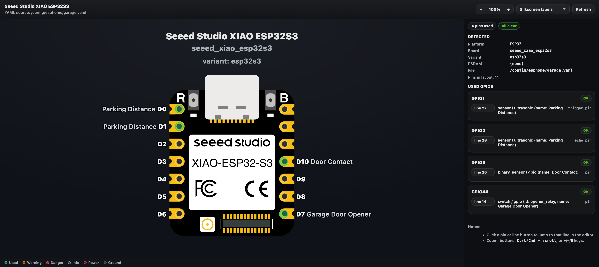
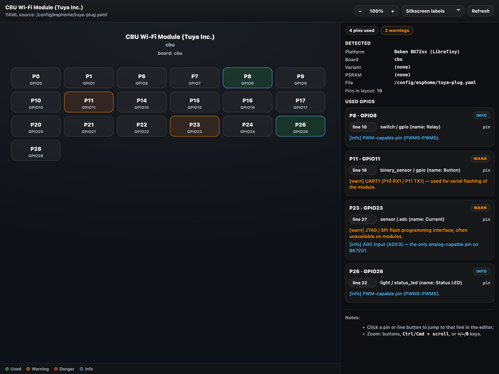

# ESPHome GPIO Pinout

[](https://marketplace.visualstudio.com/items?itemName=mikeharty.esphome-gpio-pinout)
[](https://marketplace.visualstudio.com/items?itemName=mikeharty.esphome-gpio-pinout)
[](https://marketplace.visualstudio.com/items?itemName=mikeharty.esphome-gpio-pinout)
[](LICENSE)



This extension adds a GPIO pinout overlay for ESPHome board GPIO pins. It inspects the active ESPHome YAML file, detects used GPIO pins, and renders a board pinout. Warnings are displayed for pins used in the YAML that are problematic or not available on the selected board.

## Usage

1. Open an ESPHome YAML file in VS Code (language mode must be YAML).
2. Open the pinout pane using any of these:
   - Editor title button: **GPIO Pinout** (YAML editors)
   - Command palette: **ESPHome: GPIO Pinout**
3. Optional: enable automatic opening for ESPHome-like YAML files:
   - Setting: `esphomeGpioPinout.autoOpen`
   - Default: `false`
4. Click a pin or line button to jump to the YAML location.
5. Zoom with the header controls, `Ctrl/Cmd + scroll`, or the `+` / `-` / `0` keys; click the percentage to reset.

## Supported platforms

- **ESP32** (`esp32:`) — ESP32, S2, S3, C2, C3, C5, C6, C61, H2, and P4
- **ESP8266** (`esp8266:`) — including silkscreen aliases like `D1`, `A0`, `RX`, `LED` per board
- **RP2** (`rp2:`, plus the legacy `rp2040:` key) — RP2040 and RP2350, including Raspberry Pi Pico, Pico W, Pico 2, and Pico 2 W
- **nRF52** (`nrf52:`) — including `P0.x` / `P1.x` pin notation
- **LibreTiny** (`bk72xx:` / `rtl87xx:`) — Tuya-style modules (CBU, CB2S, WB3S, WR3, ...) with `P#` / `PA##` pin names, each rendered with the module's actual broken-out pins



Pin usages are detected from `pin:`, `*_pin:`, `pin_a`–`pin_d`, `sda:`/`scl:`, and `*_pins:` lists, through substitutions (`${sub}` or `$sub`) and nested `number:` blocks. Pins that live on I/O expanders (`pcf8574`, `mcp23017`, ...) are recognized and excluded from the board pinout.

## Development

See [DEVELOPMENT.md](DEVELOPMENT.md) for setup, debugging, testing, and packaging details.

## Pinout Data Sources

Pinout data is generated from locked upstream commits and committed into this repo:

- PlatformIO board manifests (`pioarduino/platform-espressif32` — the fork ESPHome builds with — and `platform-espressif8266`) for board ID scope and SoC mapping.
- Wokwi custom board definitions (`board.json` + `board.svg`) for SVG-backed board layouts.
- Adafruit WipperSnapper board definitions for matched board GPIO subsets when no Wokwi layout exists.
- LibreTiny board definitions for `bk72xx`/`rtl87xx` module pin subsets and silkscreen aliases.
- ESPHome's board catalogs for the complete RP2040/RP2350 board set, board aliases, and newly supported ESP32 variants.
- ESP32 Pinout Studio / Espressif GPIO data for per-pin functions, RTC domain, strapping, and reset details.
- CircuitPython board pin maps for nRF52 board subsets and silkscreen aliases.
- Built-in SoC rule tables for chip-level warnings and fallback rendering.

Board artwork and source references are committed with provenance. Aggregate photo catalogs are used only to locate an original manufacturer or licensed source; images without clear redistribution rights are not copied into the extension.

Update and verify data with:

```sh
npm run pinouts:update
npm run pinouts:build
npm run pinouts:check
```

## Notes

- The extension reads from the active editor, including unsaved changes, and auto-refreshes on file save. The panel stays on the last ESPHome YAML when you switch to other files.
- Board coverage includes all current ESPHome-relevant ESP32 and ESP8266 PlatformIO IDs, the full ESPHome RP2 catalog, LibreTiny modules, and selected nRF52 boards — with board-specific grids or SoC fallback rendering when artwork is unavailable.
- The extension uses a simple YAML parser and may not handle all ESPHome YAML constructs (e.g. `!include` / `packages:` are not expanded). Please file an issue if you encounter problems.
- Feedback and contributions are welcome!

## Thanks

Thanks to the projects that provide the board and pinout source data used by this extension:

- [wokwi/wokwi-boards](https://github.com/wokwi/wokwi-boards)
- [pioarduino/platform-espressif32](https://github.com/pioarduino/platform-espressif32)
- [platformio/platform-espressif8266](https://github.com/platformio/platform-espressif8266)
- [adafruit/Wippersnapper_Boards](https://github.com/adafruit/Wippersnapper_Boards)
- [libretiny-eu/libretiny](https://github.com/libretiny-eu/libretiny)
- [esphome/esphome](https://github.com/esphome/esphome)
- [FelixKunzJr/ESPPinoutWebsite](https://github.com/FelixKunzJr/ESPPinoutWebsite)
- [adafruit/circuitpython](https://github.com/adafruit/circuitpython)
